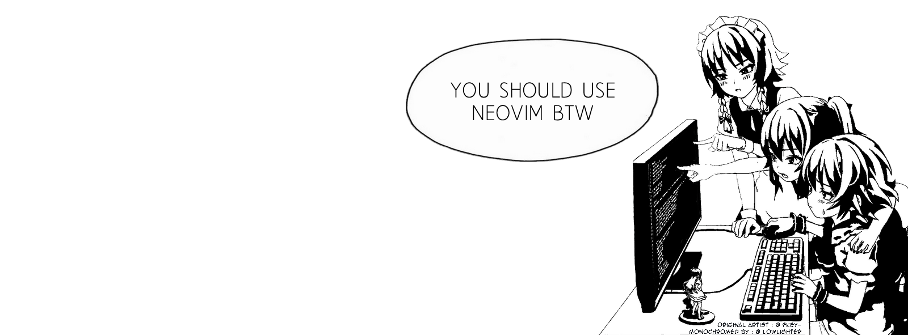

# Hi, I'm Radek! 👋

I'm a **19-year-old high school student from Poland** who enjoys coding. My hobbies outside of coding include reading, weightlifting, playing the guitar and anything music-related.

 <h2> 📊 Stats </h2> 

  

 <h2> 🎧 Recently listened to </h2> 

